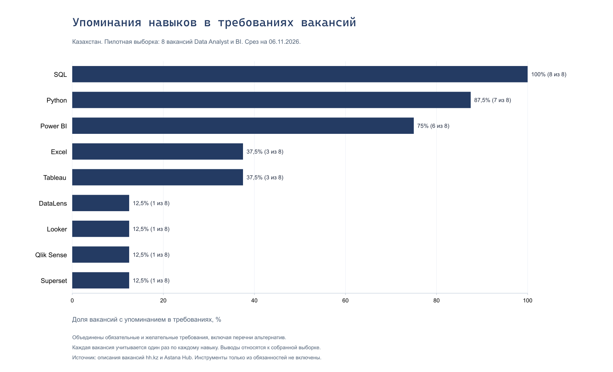

# Data Analyst and BI Skills in Astana and Almaty

By [Alina Aitmukhamet](https://github.com/lina36lena), Software Engineering student at Astana IT University.

A small study of technical skills mentioned in eight Data Analyst and BI job postings, checked on **6 November 2026**. The project uses manually collected vacancy data, PostgreSQL queries, Excel summaries and a Power BI report.

## Project goal

When preparing for a first analytics internship, a long list of tools in job postings can make every skill seem equally urgent. This project separates frequently mentioned skills from their context: whether they appear in the main requirements or as an advantage, and whether the posting requires previous experience.

SQL, Python and Power BI are the most frequently mentioned tools in this sample. Their roles differ: SQL usually appears in the main requirements, while Python is more often listed as an advantage. This distinction helps set learning priorities more clearly than a single ranking of tool names.

## Findings

The table counts **postings that mention each skill**, rather than repetitions of a word. All percentages below use the eight included postings as the denominator.

| Skill | Main requirements | Preferred requirements | Either section | Share of postings |
| --- | ---: | ---: | ---: | ---: |
| SQL | 7 | 1 | 8 | 100.0% |
| Python | 2 | 5 | 7 | 87.5% |
| Power BI | 5 | 1 | 6 | 75.0% |
| Excel | 3 | 0 | 3 | 37.5% |
| Tableau | 3 | 0 | 3 | 37.5% |
| DataLens | 1 | 0 | 1 | 12.5% |
| Looker | 1 | 0 | 1 | 12.5% |
| Qlik Sense | 1 | 0 | 1 | 12.5% |
| Superset | 1 | 0 | 1 | 12.5% |



- **SQL is the clearest first priority suggested by this sample.** It appears in all eight postings and in the main requirements of seven. All six postings requiring previous experience include SQL in their main requirements.
- **Python mentions need context.** Five of its seven mentions are in the preferred section. Its overall share of 87.5% does not mean that Python is mandatory for every role in the sample.
- **Power BI is a reasonable tool for the next BI project.** Six postings mention it, although some accept alternative tools. These results do not suggest that a beginner needs to learn every named BI product at once.

## Comparison by experience

Two postings are marked as requiring no experience, and six require previous experience. The counts below combine main and preferred requirements.

| Skill | No experience required | Previous experience required |
| --- | ---: | ---: |
| SQL | 2 of 2 | 6 of 6 |
| Python | 1 of 2 | 6 of 6 |
| Excel | 1 of 2 | 2 of 6 |
| Power BI | 1 of 2 | 5 of 6 |

Even the two postings requiring no experience differ: one places SQL in the main requirements, while the other lists it as an advantage. The overall results should therefore not be treated as a checklist of mandatory internship skills. Two postings are also too few to establish a typical entry requirement.

## Data and selection

The source workbook contains ten postings. Eight were included because their tasks involve data analysis, metrics, hypothesis testing or BI reporting. A business analyst internship at Komita Digital Technologies was excluded because its tasks focus on software implementation and documentation. A database analyst posting at TM-SYSTEMS remains marked for review because its brief description focuses on database design and does not establish a data analysis role.

The included sample contains four postings from Astana and four from Almaty. Seven were found on hh.kz and one on Astana Hub.

| Company | Posting | City |
| --- | --- | --- |
| iKapitalist Ltd | [Data Analyst / BI Analyst](https://astanahub.com/ru/vacancy/6877) | Astana |
| Beeline | [Data Analyst CX](https://astana.hh.kz/vacancy/138750477) | Astana |
| BI Group. BI Service | [Data Analyst](https://astana.hh.kz/vacancy/139112599) | Astana |
| AIR ASTANA | [BI Analyst](https://astana.hh.kz/vacancy/138917795) | Almaty |
| Kaspi.kz | [Senior Data Analyst](https://astana.hh.kz/vacancy/138799670) | Almaty |
| Tekhinvest Proekt | [Analyst](https://astana.hh.kz/vacancy/139034666) | Almaty |
| Beeline | [Data Analyst, Mobile CVM](https://astana.hh.kz/vacancy/139131014) | Astana |
| Kcell | [Data Analyst CVM](https://astana.hh.kz/vacancy/139109674) | Almaty |

Each record retains its source link, check date, selection status and reason for inclusion or exclusion. The two Beeline postings cover different roles and are counted separately. The links refer to a historical snapshot; their availability and current status may change.

## Counting rules

Only rows with `selection_status = 'Да'` in `analyst_project.vacancies` enter the calculations. Skills are matched without case sensitivity in `required_skills` and `preferred_skills`, which contain manually transcribed requirements.

The dictionary covers the nine skills in the findings table. SQL matches SQL, PostgreSQL, MySQL and MSSQL, but does not match NoSQL. Power BI, DataLens and Qlik Sense allow spelling variants with or without spaces.

Each posting contributes at most one mention per skill per section. The combined count uses a logical OR, so a skill found in both sections is counted once in the overall result. Percentages divide that count by the number of postings in the relevant group. For example, the overall Power BI share is `6 / 8 × 100 = 75%`.

The main requirements count includes lists of alternatives. A phrase such as “Power BI, Tableau or similar tools” counts as a mention of both products, but does not imply that applicants must know both. Counts across different skills can therefore add up to more than eight.

Tools mentioned only in job duties are excluded from these requirement counts. For example, Kcell's mentions of Excel and Power BI in its duties are retained in the notes but do not contribute to the totals. An omitted tool name does not establish that the tool is unused at work.

Experience groups use `experience_card`: four included postings show 1–3 years, two show 3–6 years and two require no experience. Requirements from the description are stored separately in `experience_description` because the two can differ. Experience ranges are not converted into Junior, Middle or Senior labels.

## Power BI report

Download [the Power BI report](reports/vacancies-dashboard.pbix) and open it in Power BI Desktop. Its single page contains skill mention counts, a comparison of main and preferred requirements, a sample-size card and a skill slicer. The date and cities are shown on the page.

The model imports the `SkillSummary` table from the Excel report. Each row represents a skill, so the sample size of eight is repeated across nine rows. The card uses `MAX` of that field. Selecting Python shows seven mentions, including two in the main section and five in the preferred section; the card remains at eight because it represents the original sample size.

The slicer filters by skill. The experience comparison is available in Excel and SQL. Updates follow the PostgreSQL → Excel → Power BI sequence, with manual transfer between stages. The source vacancy text, workbook headings and dashboard labels are in Russian.

## Repository layout

```text
data/
  vacancies-2026-11-06.xlsx
  skills-report-2026-11-06.csv
sql/
  01-load-vacancies.sql
  02-skill-summary.sql
  03-experience-summary.sql
  04-skills-by-experience.sql
reports/
  vacancies-skills-report-2026-11-06.xlsx
  vacancies-dashboard.pbix
images/
  skills-mentions-2026-11-06.png
README.md
.gitignore
```

## Project files

| File | Purpose |
| --- | --- |
| [data/vacancies-2026-11-06.xlsx](data/vacancies-2026-11-06.xlsx) | Ten source postings, requirements, links and selection decisions |
| [sql/01-load-vacancies.sql](sql/01-load-vacancies.sql) | Schema, table and snapshot loading |
| [sql/02-skill-summary.sql](sql/02-skill-summary.sql) | Counts and percentages for nine skills |
| [sql/03-experience-summary.sql](sql/03-experience-summary.sql) | Distribution of experience ranges from posting cards |
| [sql/04-skills-by-experience.sql](sql/04-skills-by-experience.sql) | Comparison of four skills by experience group |
| [data/skills-report-2026-11-06.csv](data/skills-report-2026-11-06.csv) | Exported overall summary from PostgreSQL |
| [reports/vacancies-skills-report-2026-11-06.xlsx](reports/vacancies-skills-report-2026-11-06.xlsx) | Summary tables, percentage formulas and experience comparison |
| [reports/vacancies-dashboard.pbix](reports/vacancies-dashboard.pbix) | Interactive Power BI report |
| [images/skills-mentions-2026-11-06.png](images/skills-mentions-2026-11-06.png) | Static chart of overall skill counts |

## Reproducing the analysis

The full workflow requires PostgreSQL, a SQL client, Excel and Power BI Desktop. DBeaver was used as the SQL client.

1. Run `sql/01-load-vacancies.sql` in a separate PostgreSQL database. It creates the `analyst_project` schema and loads ten records: eight marked `Да` (included), one `Нет` (excluded) and one `Проверить` (review). Rerunning it skips existing `source_row` values; it does not automatically apply edits from the source workbook.
2. Run `sql/02-skill-summary.sql`, `sql/03-experience-summary.sql` and `sql/04-skills-by-experience.sql`. The expected result sizes are 9, 3 and 8 rows. Check the overall counts against SQL = 8, Python = 7 and Power BI = 6.
3. When updating the data, transfer the counts to the `SkillSummary` and `SkillsByExperience` tables in the Excel report. Excel calculates shares from those counts. SQL returns percentages on a 0–100 scale, while Excel stores fractions on a 0–1 scale with percentage formatting. The saved CSV uses UTF-8, a semicolon delimiter and a decimal comma.
4. Open `reports/vacancies-dashboard.pbix`. The imported model supports viewing without connecting to PostgreSQL. To refresh on another computer, update the Excel source path to the local copy of `reports/vacancies-skills-report-2026-11-06.xlsx`, then refresh the report.

## Limitations and next steps

This is a small, manually selected sample from two cities on one date. Six of eight postings require experience, and three are in telecom. The results depend on this mix of roles and do not describe the entire analytics job market in Kazakhstan. In the no-experience group, one posting changes a share by 50 percentage points.

Manual transcription and dictionary coverage affect the counts. Tool mentions do not measure the required depth of knowledge, cover all professional skills or determine an applicant's readiness. Salary is disclosed in only one included posting, so the project draws no salary conclusions.

The next research step is to define the sources, search queries and collection period in advance, collect more postings for beginners and repeat the comparison. A separate distinction between a specifically required tool and a list of accepted alternatives would also improve the analysis. Further report improvements concern label readability and consistent skill ordering across charts.
